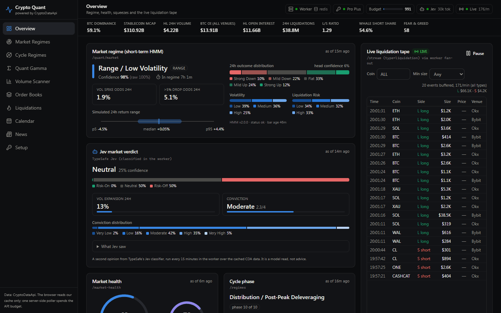
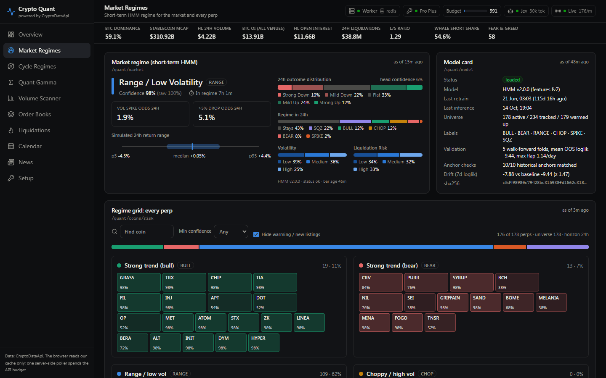
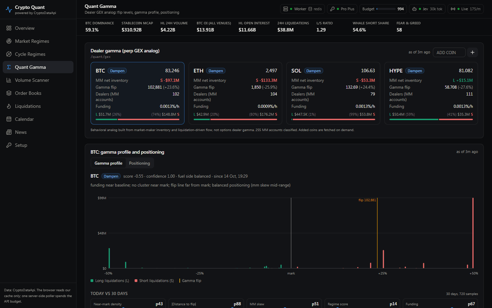
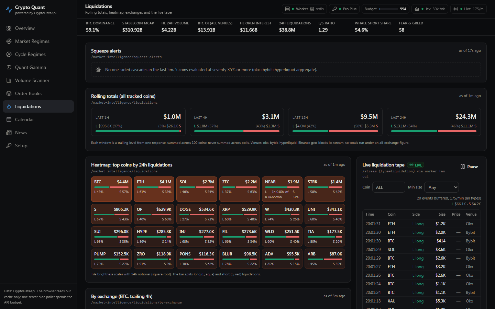
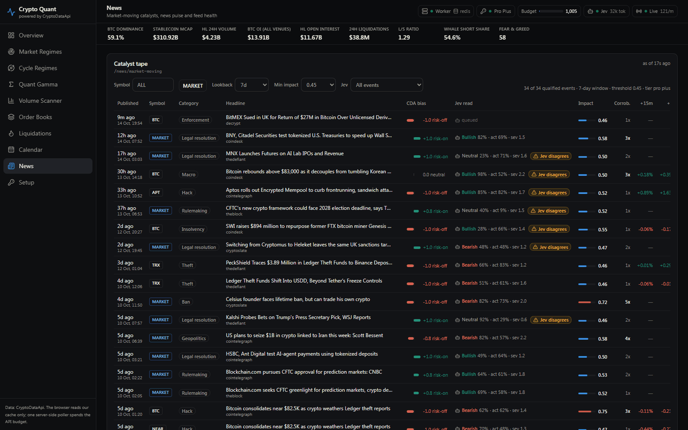
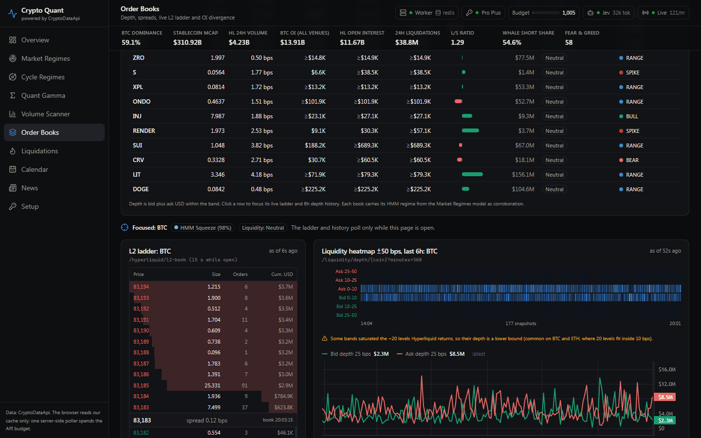

# Crypto Quant Dashboard

A real-time quant dashboard for Hyperliquid perps and the wider crypto market, powered by
[CryptoDataApi](https://cryptodataapi.com) (CDA). Market regimes, cycle phases, dealer gamma,
order-book depth, liquidations and market-moving news on one screen, with a second opinion from
TypeSafe's Jev classifier. Every number comes from the CDA REST API or its live event stream; the
app does not model anything CDA already computes.

**[Open the live demo](https://crypto-data-api.github.io/crypto-quant-dashboard/)** (no key needed) ·
[Set up with your agent](#set-up-with-your-agent) · [Quick start](#quick-start) ·
[Demo mode](#demo-mode)

[](docs/screenshots/overview.png)

<table>
  <tr>
    <td width="50%" valign="top">
      <a href="docs/screenshots/market-regimes.png"></a><br>
      <b>Market Regimes.</b> The short-term HMM regime with its 24h outcome distribution, the model card, and every perp grouped by regime.
    </td>
    <td width="50%" valign="top">
      <a href="docs/screenshots/quant-gamma.png"></a><br>
      <b>Quant Gamma.</b> A dealer GEX analog per coin with gamma flip levels, funding and positioning, plus the gamma profile around the mark.
    </td>
  </tr>
  <tr>
    <td width="50%" valign="top">
      <a href="docs/screenshots/liquidations.png"></a><br>
      <b>Liquidations.</b> Rolling 1h to 24h totals split long and short, a heatmap of the most liquidated coins, and the live tape.
    </td>
    <td width="50%" valign="top">
      <a href="docs/screenshots/news.png"></a><br>
      <b>News.</b> The market-moving catalyst tape with CDA's bias beside Jev's read. A badge flags every event where the two disagree.
    </td>
  </tr>
  <tr>
    <td width="50%" valign="top">
      <a href="docs/screenshots/order-books.png"></a><br>
      <b>Order Books.</b> Depth across the top 25 perps, then the focused coin's live L2 ladder and its 6-hour ±50 bps depth heatmap.
    </td>
    <td width="50%" valign="top">
      <b>Also in the app:</b> Cycle Regimes (the 10-phase cycle ring and playbook), Volume Scanner, Calendar
      (event regime, macro calendar and token unlocks) and a Setup page with a copyable agent prompt.<br><br>
      Screenshots are from a local instance with a Pro Plus key, 14 Oct 2026.
    </td>
  </tr>
</table>

## Pages

| Route | Page | Main CDA sources |
|---|---|---|
| `/` | Overview | `/quant/market`, `/market-health`, `/regimes`, `/market-intelligence/liquidations`, `/squeeze-alerts`, live stream |
| `/market-regimes` | Market Regimes (short-term HMM) | `/quant/market`, `/quant/coins/risk`, `/quant/coins/{symbol}`, `/quant/model` |
| `/regimes` | Cycle Regimes (10 phases) | `/regimes`, `/market-health`, six `/…/score` endpoints |
| `/quant-gamma` | Quant Gamma (dealer GEX analog) | `/quant/gex`, `/quant/gex/history`, `/quant/positioning` |
| `/volume-scanner` | Volume Scanner | `/volume/scanner`, `/volume/scanner/{symbol}` |
| `/quant-order-books` | Order Books | `/liquidity/depth`, `/liquidity/depth/{coin}`, `/hyperliquid/l2-book`, `/liquidity/regime`, `/liquidity/oi-divergence` |
| `/liquidations` | Liquidations | `/market-intelligence/liquidations`, `/liquidations/by-exchange`, `/squeeze-alerts`, live stream |
| `/calendar` | Calendar | `/event/regime/score`, `/event/calendar`, `/event/regime/{symbol}`, `/supply/unlocks` |
| `/news` | Market-moving news | `/news/market-moving`, `/news/pulse`, `/news/sources`, `/news/coin/{symbol}` |
| `/setup` | Setup | none: keys, demo status and the agent prompt below |

A second opinion from TypeSafe's Jev classifier runs in the worker over the cached data: its read
of each news catalyst, a cascade probability on squeeze alerts, and a market verdict card on the
overview (see [Jev classifier](#jev-classifier-typesafe-system-one)). The news tape also appears as
a compact panel beside the liquidation tape on `/liquidations`, and per-coin news appears in the
Market Regimes coin drawer.

Every page shares the header stat strip and the system status pills (worker, API key, daily
budget meter, Jev, stream source). Every panel shows a "data as of" time, a stale badge, and an
explicit state when there is no data: waiting for the first poll, Pro plan required, key rejected,
rate limited, daily budget reached, fetch failed, worker offline, or not in the demo data.

**Status:** Phase 0 (foundation), Phase 1 (the seven pages), the market-moving news page, the Jev
classifier and demo mode from [docs/PLAN.md](docs/PLAN.md) are built and verified against live
data with a Pro Plus key. Phase 2 (history and backtesting) is unblocked by the Pro Plus key; its
first three datasets are already registered.

## Set up with your agent

Paste this into your AI coding agent (Claude Code, Cursor, Codex and so on). It installs the app,
creates a free CryptoDataApi key with your email if you do not have one, and verifies that the
worker sees it. The same prompt is on the app's `/setup` page with a copy button.

```text
Set up the Crypto Quant Dashboard on this machine for me and report back when it is running.

1. Prerequisites: check for git, Node.js 20.12 or newer (22 recommended), pnpm 10 (run "corepack enable", or "npm i -g pnpm@10" if corepack cannot write to the Node folder) and Docker. Install anything missing or tell me what to install.

2. Get the code:
   git clone https://github.com/Crypto-Data-API/crypto-quant-dashboard.git
   cd crypto-quant-dashboard
   pnpm install
   cp .env.example .env

3. CryptoDataApi key (required for live data). If I do not already have one, ask me for my email address, then create a free key:
   curl -s -X POST https://cryptodataapi.com/api/v1/auth/keys -H "Content-Type: application/json" -d "{\"email\": \"MY_EMAIL\"}"
   The response field "api_key" (starts with cdk_) is shown only once. Write it into .env as CDA_API_KEY=<key>. Tell me to confirm the email CryptoDataApi sends: confirming switches on Pro for 24 hours. Paid Pro and Pro Plus plans are at https://cryptodataapi.com/pricing, and agent docs are at https://cryptodataapi.com/ai-agents.

4. TypeSafe key (optional, powers the Jev classifier panels). Ask me whether I want it. If yes, ask me to create a key at https://console.typesafe.ai/settings/keys and paste it, then write it into .env as TYPESAFE_API_KEY=<key>. If not, leave it empty: those panels show demo data.

5. Never print, log or commit either key. .env is already gitignored.

6. Start Redis: docker compose up -d redis

7. Start the app from the repo root and keep it running: pnpm dev
   (worker on http://localhost:4100, web app on http://localhost:3001)

8. Verify: open http://localhost:3001 and run
   curl -s http://localhost:3001/api/status
   Confirm worker.keyConfigured is true (and jev.configured is true if a TypeSafe key was set). If keyConfigured is false, the worker did not see the key: check that .env is in the repo root, then stop and restart pnpm dev.

9. Report what you did, which keys are configured (without showing them) and the /api/status summary.
```

This text lives in [apps/web/src/features/setup/agent-prompt.ts](apps/web/src/features/setup/agent-prompt.ts);
change both places together.

## Quick start

### Prerequisites

- **Node.js 20.12 or newer** (developed on 22.6). The worker uses `process.loadEnvFile`.
- **pnpm 10.** Run `corepack enable`, or `npm i -g pnpm@10` if corepack cannot write to your
  Node install directory.
- **Docker** for the local Redis (optional: without Redis everything still runs in memory).
- **A CDA key** for live data (optional: without it the app runs in [demo mode](#demo-mode)). A
  free key comes from `POST https://cryptodataapi.com/api/v1/auth/keys` with your email (see the
  agent prompt above); the dashboard is sized for Pro or Pro Plus.

### Setup

```bash
git clone https://github.com/Crypto-Data-API/crypto-quant-dashboard.git
cd crypto-quant-dashboard
pnpm install
cp .env.example .env          # then set CDA_API_KEY=cdk_live_... (or leave it empty for the demo)
docker compose up -d redis    # local Redis on 6379
pnpm dev                      # worker (port 4100) + web (port 3001) together
```

Open <http://localhost:3001>. To run the two processes in separate terminals instead:

```bash
pnpm dev:worker   # poller + stream relay, http://localhost:4100
pnpm dev:web      # Next.js, http://localhost:3001
```

There is one `.env`, at the repo root; no `.env.local` copies are needed. The worker loads the whole
file (real environment variables win). The web app's `next.config.ts` loads the same file but takes
only `REDIS_URL`, `WORKER_URL`, `WORKER_TOKEN` and `NEXT_PUBLIC_STREAM_URL`: it never calls CDA, so
the key stays out of the Next.js process entirely.

Production build and start:

```bash
pnpm build
pnpm start:worker   # node apps/worker/dist/index.js
pnpm start:web      # next start on port 3001
```

## Demo mode

The dashboard runs without any key, from real responses saved in [docs/samples](docs/samples)
(captured on 14 Oct 2026 with a Pro Plus CDA key and Jev 1.13.0). There are two ways to see it.

- **Hosted static demo** at <https://crypto-data-api.github.io/crypto-quant-dashboard/>. GitHub
  Actions rebuilds it from `main` on every push.
- **Local keyless run.** Follow the quick start and leave `CDA_API_KEY` empty.

### Keyless worker

- **Saved data instead of calls.** With `CDA_API_KEY` empty the worker seeds every keyed dataset
  from `docs/samples` at startup and makes no keyed CDA calls. It still polls the keyless
  `/api/v1/health`. Panels carry a "Demo sample" badge in place of the as-of time; its tooltip
  gives the capture time.
- **Per-symbol panels** (coin drawers, the L2 ladder, depth and GEX history, per-coin news) have
  samples for a few symbols, mostly BTC and ETH. Any other symbol shows "Not in the demo data",
  lists the symbols that are, and links to `/setup`.
- **Jev.** With `TYPESAFE_API_KEY` empty (or `JEV_ENABLED=false`) the Jev panels show saved Jev
  reads. While CDA itself is in demo, Jev is not called even with a key, because it would only
  classify saved samples.
- **Live tape.** The tape plays CDA's free `/api/v1/stream/delayed` preview at its original pace
  (about 30 minutes behind, labelled DELAYED PREVIEW). If the preview fails twice, the worker
  replays the saved stream captures instead (labelled DEMO REPLAY) and retries the preview every
  10 minutes. `STREAM_SOURCE=replay` forces the replay.
- **Banner.** Every page shows a demo banner with the capture window and links to `/setup`, and
  `/api/status` reports `worker.demo`.
- **Going live.** Set `CDA_API_KEY` (and optionally `TYPESAFE_API_KEY`) and restart the worker.
  Scheduled datasets are replaced by live data on the first poll.

### Static build (GitHub Pages)

```bash
pnpm --filter @cqd/web build:static          # writes apps/web/out
python -m http.server 8080 -d apps/web/out   # or any static file server
```

`build:static` turns `docs/samples` into `apps/web/public/samples` (one demo envelope per dataset
and symbol, a manifest, the stream replay timeline and a status document), then runs `next build`
with `NEXT_PUBLIC_DATA_MODE=static` and `output: "export"`. The `/api` route handlers are named
`route.api.ts`, and `api.ts` is a page extension only in server mode, so the export leaves them out.
`GITHUB_PAGES=true` serves the site under `/crypto-quant-dashboard`.
`pnpm --filter @cqd/web samples:static` refreshes only `public/samples`, which is gitignored.

[.github/workflows/pages.yml](.github/workflows/pages.yml) runs the sample check, the static build
and the deploy. It needs **Settings > Pages > Source: GitHub Actions** once per repository.

### What the static demo cannot do

- **No live updates.** It is a snapshot; nothing polls and no key is ever used.
- **Bundled symbols only** for per-symbol panels, as in the keyless worker.
- **Replayed tape.** The browser replays the saved stream captures itself, re-stamped to now.
- **Capture times.** Panels show the "Demo sample" badge instead of an as-of time, so nothing turns
  stale; the badge tooltip gives the capture time.
- **No server.** There are no `/api` routes; the status pill reads a static document.

## Environment variables

All variables live in the repo-root `.env` (see [.env.example](.env.example)). The worker loads the
whole file; the web app loads only `REDIS_URL`, `WORKER_URL`, `WORKER_TOKEN` and
`NEXT_PUBLIC_STREAM_URL`, so the CDA key never enters the Next.js process. The web app's port is
fixed at 3001 in `apps/web/package.json` (`next dev -p 3001`, `next start -p 3001`).

| Variable | Default | Used by | Purpose |
|---|---|---|---|
| `CDA_API_KEY` | empty | worker | CDA key (`cdk_live_...`). Empty means demo mode. |
| `CDA_BASE_URL` | `https://cryptodataapi.com` | worker | API origin. |
| `REDIS_URL` | `redis://localhost:6379` | both | Shared cache. `off` disables Redis; unreachable Redis falls back to memory. |
| `WORKER_PORT` | `4100` | worker | Worker HTTP port. |
| `WORKER_URL` | `http://localhost:4100` | web | Where the web app reaches the worker (fallback reads, stream proxy). |
| `WORKER_TOKEN` | empty | both | Optional bearer token for the worker's `/status` and `/data` routes. |
| `CDA_RATE_PER_MIN` | `100` | worker | Token bucket rate (max 115). Lowered automatically to the key's per-minute limit minus 2. |
| `CDA_DAILY_BUDGET` | `30000` | worker | The dashboard's daily keyed-call budget. Capped automatically at 95% of the key's daily limit. |
| `ON_DEMAND_MAX` | `16` | worker | Maximum on-demand datasets polled at once; extra requests wait as pending. |
| `WORKER_CORS_ORIGIN` | `*` | worker | CORS origin for the public `/stream` endpoint (for example `http://localhost:3001`). |
| `STREAM_SOURCE` | `auto` | worker | `auto`, `live`, `delayed`, `replay` (saved demo events) or `off`. |
| `GEX_SYMBOLS` | `BTC,ETH,SOL,HYPE` | worker | Coins polled on a schedule for GEX and positioning. |
| `LOG_LEVEL` | `info` | worker | `debug`, `info`, `warn`, `error`. Set `LOG_FORMAT=pretty` for terminal output. |
| `NEXT_PUBLIC_STREAM_URL` | empty | web | Production only: point browsers straight at the worker's `/stream`. |
| `TYPESAFE_API_KEY` | empty | worker | TypeSafe key for the Jev classifier (Bearer auth). Empty turns the classifier off. |
| `JEV_ENABLED` | `true` | worker | `false` turns the classifier off even with a key. |
| `JEV_MODEL` | `jev-latest` | worker | Model sent on every request; pin a version such as `jev-1.13.0` to freeze answers. |
| `JEV_RATE_PER_MIN` | `60` | worker | Our request ceiling (the API allows 1,200/min). |
| `JEV_DAILY_CALLS` / `JEV_DAILY_INPUT_TOKENS` | `3000` / `2000000` | worker | Daily budget; the classifier pauses until 00:00 UTC when either is reached. |
| `JEV_VERDICT_MINUTES` | `15` | worker | Market verdict cadence. |

Build-time only, for the static export: `NEXT_PUBLIC_DATA_MODE=static` (set by `build:static`) and
`GITHUB_PAGES=true` (base path `/crypto-quant-dashboard`).

## Architecture

```
                 CryptoDataApi (REST + SSE)
                          |
                          |  one API key, 100 req/min token bucket, daily budget governor
                          v
  apps/worker  ---------------------------------------------------------------
  | poller: dataset registry -> fetch -> Zod drift check -> envelope          |
  | stream relay: 1 SSE connection to CDA -> ring buffer (5,000 events)       |
  | demo: docs/samples -> seeded envelopes and stream replay when keyless     |
  | HTTP :4100  /healthz  /status  /data/:dataset  /stream                    |
  ---------------------------------------------------------------------------
          | envelopes, heartbeat, call counters        ^ on-demand interest
          v                                            |
        Redis (cqd:data:*, cqd:demand, cqd:calls:*, cqd:worker:*)
          |
          v
  apps/web (Next.js 15) ------------------------------------------------------
  | /api/data/[dataset]  reads Redis; falls back to the worker's /data        |
  | /api/status          worker heartbeat, budget, stream state               |
  | /api/stream          same-origin SSE proxy to the worker's /stream        |
  | pages: TanStack Query on /api/data, EventSource on /api/stream            |
  ---------------------------------------------------------------------------
                          ^
                       browsers (never see the key, never call CDA)
```

- **One poller.** `apps/worker` is the only process that talks to CDA. A Redis lock
  (`cqd:worker:lock`, 15 s TTL) makes sure a second worker stands by instead of doubling spend.
- **Envelopes.** Each dataset is cached as `{status, data, fetchedAt, asOf, intervalMs,
  staleAfterMs, error, validation}`. A failed fetch keeps the last good data, so panels show
  stale data with a badge rather than going blank. Demo envelopes add `demo.capturedAt`.
- **Validation.** Responses are checked against Zod schemas generated from the OpenAPI spec
  (plus hand-written loose schemas for the endpoints the spec leaves untyped). A failure is
  logged and recorded on the envelope; the data is still served.
- **On-demand datasets.** Per-symbol endpoints (coin drawer, L2 book, depth history, GEX history,
  volume series, catalyst overlay) poll only while someone is looking. Each read registers
  interest in a Redis sorted set with a short TTL; the worker polls active entries at a higher
  limiter priority and drops them when interest lapses.
- **Redis fallback.** If Redis is unset or down, the worker keeps an in-memory cache and the
  web app reads through the worker's `/data` route. If neither is reachable the UI shows
  "Worker offline".

### Stream fan-out decision

The worker owns the fan-out. It holds the single upstream SSE connection to CDA (reconnecting with
`since_id`, so nothing is lost), keeps a 5,000-event ring buffer, and serves browsers from its own
`/stream` endpoint with server-side type, symbol and size filters. Reconnecting browsers send
`Last-Event-ID` and are replayed from the buffer; new connections get a short backfill so the tape is
never empty.

`apps/web` exposes `/api/stream` as a thin same-origin proxy to that endpoint, which keeps local
development to one origin. On a serverless host (for example Vercel), long-lived function
responses are capped, so set `NEXT_PUBLIC_STREAM_URL` to the worker's public `/stream` URL and
browsers connect to the worker directly (it sends CORS headers; restrict them with
`WORKER_CORS_ORIGIN`). This avoids a Redis pub/sub hop and keeps CDA's 3-stream limit at one
connection no matter how many browsers are open.

## Rate-limit budget

The key is **Pro Plus**: 120 requests per minute and 50,000 per day, counted per key and shared with
any other tooling that uses the same key. The dashboard targets well under that: 100 requests per
minute and a 30,000-call daily budget, leaving 20,000 calls a day for other tooling. The budget is
enforced in four layers.

0. **Key introspection.** At startup and every 10 minutes the worker reads `GET /api/v1/auth/keys/me`
   (about 144 calls/day). It sets the limiter to `min(CDA_RATE_PER_MIN, per_minute_limit - 2)`,
   caps the daily budget at 95% of `daily_limit`, tracks the whole key's `requests_today`, and
   skips any dataset whose `tier` is above the key's tier without spending a call. A Pro key is
   therefore held to 28/min and 9,500/day automatically.
1. **Token bucket (per minute).** 100 requests/minute with burst 1, so at most 101 requests start in
   any rolling minute against the 120 limit. Scheduled polls, on-demand reads and stream
   reconnects share it; on-demand reads have priority. A 429 pauses the whole bucket for
   `Retry-After` (or exponential backoff) and retries up to 3 times. 401, 402 and 403 are never
   retried: the envelope records `unauthorized` or `pro_required` and the worker re-checks hourly.
2. **Daily counter.** Every keyed HTTP attempt increments `cqd:calls:<UTC date>` plus per-dataset
   and per-status hashes (kept 3 days). A restarted worker reads today's count back from Redis.
   The header's Budget pill shows calls used today.
3. **Governor (per day).** The worker compares calls used with a pace line (the daily budget spread
   evenly over the UTC day, plus 4% slack for startup). Ahead of the line it stretches every
   interval by 2x (4x past 95% of the budget). Within 25 calls of the budget, or when the whole
   key is within 1% of its daily limit, it pauses keyed polling until 00:00 UTC and panels show
   "Daily budget reached". The Budget pill shows the dashboard's calls and the whole key's usage.

Scheduled load at the registry's intervals is **326 calls/hour (7,824/day)**, about a quarter of the
dashboard's budget. The L2 ladder is the most expensive on-demand dataset at 240 calls/hour while
the order-book page is open. Intervals follow CDA's own refresh cadences, so the extra Pro Plus
headroom is left for on-demand reads and Phase 2 rather than spent on faster polling.

| Dataset | Endpoint | Interval | Calls/hour |
|---|---|---|---|
| quant-market | `/quant/market` | 5 min | 12 |
| quant-coins-risk | `/quant/coins/risk` | 5 min | 12 |
| quant-model | `/quant/model` | 60 min | 1 |
| regimes | `/regimes` | 15 min | 4 |
| market-health | `/market-health` | 5 min | 12 |
| score-volatility, -policy, -security, -event, -meme | `/…/regime/score` | 15 min each | 20 |
| derivatives-summary | `/derivatives/summary?coin=BTC` | 5 min | 12 |
| quant-gex | `/quant/gex?symbol=BTC,ETH,SOL,HYPE` | 5 min | 12 |
| quant-positioning | `/quant/positioning?symbol=…` | 5 min | 12 |
| quant-whales | `/quant/whales` | 5 min | 12 |
| volume-scanner | `/volume/scanner` | 2 min | 30 |
| liquidity-depth | `/liquidity/depth` | 2 min | 30 |
| liquidity-regime | `/liquidity/regime` | 5 min | 12 |
| oi-divergence | `/liquidity/oi-divergence` | 5 min | 12 |
| liquidations | `/market-intelligence/liquidations` | 2 min | 30 |
| liquidations-by-exchange | `/market-intelligence/liquidations/by-exchange` | 5 min | 12 |
| squeeze-alerts | `/market-intelligence/squeeze-alerts` | 1 min | 60 |
| event-calendar | `/event/calendar?window_days=30` | 30 min | 2 |
| supply-unlocks | `/supply/unlocks?window_days=30` | 60 min | 1 |
| news-market-moving | `/news/market-moving?hours=168&limit=200` | 5 min | 12 |
| news-pulse | `/news/pulse?hours=24` | 5 min | 12 |
| news-sources | `/news/sources` | 15 min | 4 |

On-demand datasets: `quant-coin` (5 min), `quant-gex-coin` (5 min), `gex-history` (30 min),
`volume-detail` (10 min), `l2-book` (15 s), `depth-history` (2 min), `event-symbol` (30 min),
`news-coin` (5 min), and the
Pro Plus `quant-history`, `quant-whales-history` and `positioning-ladder` (registered for Phase 2,
not yet used by a page). At most 16 run at once (`ON_DEMAND_MAX`). Tune intervals in
[packages/schemas/src/datasets.ts](packages/schemas/src/datasets.ts); `budgetPerHour()` recomputes
the scheduled total.

### Adding a dataset

1. Add an entry to `DATASETS` in [packages/schemas/src/datasets.ts](packages/schemas/src/datasets.ts).
   The `path` is type-checked against the OpenAPI spec. Set `tier` (`free`, `pro`, `pro_plus`),
   an `intervalMs`, and either nothing (scheduled), a `param` (on-demand per symbol) or
   `onDemand: true`. Query values may be functions, for example
   `start: (now) => new Date(now - 7 * DAY).toISOString()`.
2. Add its payload type to `DatasetDataMap` and its Zod schema to `validators.ts` (run `pnpm gen`
   if the schema comes from the spec).
3. Save a real response in `docs/samples` and list it in `docs/samples/index.json` (with `param`
   for a per-symbol dataset). `check-samples` fails while a dataset has no demo sample.
4. Read it from a page with `useDataset("<id>", { param })` inside a `Panel`.

The worker, cache, proxy route, panel states, tier gating, budget accounting and both demo modes
need no changes.

## Jev classifier (TypeSafe System One)

The worker sends compact JSON snapshots of already-cached CDA data to
`POST https://api.typesafe.ai/v1/systemone` through the official `@typesafe-ai/sdk` (Bearer auth) and
caches the answers as three datasets. The web app reads them like any other dataset; it never sees
`TYPESAFE_API_KEY`.

| Dataset | What is classified | Questions | Cadence and caching |
|---|---|---|---|
| `jev-news` | Each event on the news tape or an open coin drill-down: headline, category, symbol, sources, CDA's bias and impact | `bias` choice (bullish, bearish, neutral), `actionable` noul (a concrete dated market event, not commentary), `severity` score 0 to 4 (noise to market-wide shock) | New events every minute; one call per event id and model version, cached permanently in Redis |
| `jev-squeeze` | Each active squeeze alert, with the coin's regime probabilities and liquidity regime | `cascade` noul: a genuine cascade likely to continue over the next hour | Every minute; one call per symbol, direction and UTC hour |
| `jev-market-verdict` | Market regime, market health, cycle regime, news pulse top 10, squeeze summary, event risk | `stance` choice (risk_on, risk_off, neutral), `vol_expansion_24h` noul, `conviction` score 0 to 4 | Every 15 minutes |

Where it shows: a Jev column beside CDA's bias in the `/news` tape (with a "Jev disagrees" badge
when the direction differs from the sign of CDA's bias, and an agree/disagree filter), the same read
in the liquidations news panel and coin drawers, a cascade pill on squeeze alerts, and a verdict
card next to the hero regime card on the overview with a "what Jev saw" list of input as-of times.

**Costs.** TypeSafe bills input tokens only. Measured per call: about 600 input tokens for a news
event, 1,100 for a squeeze alert and 2,700 for the market verdict. A quiet day is roughly
96 verdicts (260k tokens) plus a handful of new news events and alerts, so about 0.3M input tokens
and 150 calls. The first run on a fresh Redis also classifies the whole 7-day news tape once (about
33 events, 20k tokens). Daily calls and input tokens are counted (`cqd:jev:<date>:*` in Redis) and
capped by `JEV_DAILY_CALLS` and `JEV_DAILY_INPUT_TOKENS`; the header's Jev pill and
`/api/status` (`jev` block) show the counts, the model and the last error.

**Failures.** The SDK retries 408, 429 and 5xx with backoff and honours `Retry-After`; a 429 also
pauses our own token bucket. 401 and 403 are never retried: the classifier pauses for an hour and
the panels show the error. Responses are validated with Zod at the boundary.

**Model versions.** `JEV_MODEL=jev-latest` resolves server-side (currently `jev-1.13.0`). News and
squeeze reads are keyed by the resolved version, so when upstream moves to a new version each event
is classified once more under it. Pin `JEV_MODEL` to keep answers frozen.

**Turning it off.** Set `JEV_ENABLED=false` (or leave `TYPESAFE_API_KEY` empty) and restart the
worker. The Jev panels then show the saved demo reads with a "Demo sample" badge; nothing else
changes.

Real request/response pairs are in [docs/samples/jev](docs/samples/jev); refresh them with
`pnpm --filter @cqd/worker jev:samples` (three calls, about 4,400 input tokens, inputs read from a
running worker).

## Project structure

```
crypto-quant-dashboard/
  apps/
    web/                    Next.js 15 App Router, Tailwind v4, shadcn-style UI, TanStack Query
      src/app/              pages and /api routes (route.api.ts: data, status, stream)
      src/components/       app shell (demo banner, status pills), Panel (freshness + states), charts, ui
      src/features/         one folder per page area (market, regimes, gamma, volume, books,
                            liquidations, calendar, news, setup)
      src/lib/              hooks (datasets, stream, clock), mode.ts (server or static), formatting
      src/server/store.ts   Redis reader with worker fallback
      scripts/build-static.ts   static export for GitHub Pages
    worker/                 long-lived Node process
      src/poller.ts         dataset scheduler, on-demand loop, envelopes
      src/budget.ts         daily budget governor
      src/cache.ts          memory cache with Redis mirror, demand set, call counters
      src/demo.ts           keyless demo: loads docs/samples, seeds envelopes, stream replay events
      src/stream/           CDA SSE relay, delayed preview, demo replay, fan-out hub
      src/jev/              TypeSafe Jev client (SDK wrapper), question sets, state builders, classifier
      src/http.ts           /healthz, /status, /data/:dataset, /stream
  packages/
    cda-client/             openapi.json, generated types, transport, token bucket (see its README)
    schemas/                Zod schemas, dataset registry, envelope, demo helpers, check-samples
  docs/
    PLAN.md                 development plan
    samples/                verbatim Pro Plus responses for every endpoint used, with index.json;
                            also the data behind both demo modes
    screenshots/            README images
    design/                 Claude Design reference export for the redesign
  .github/workflows/        ci.yml (typecheck, lint, samples, build), pages.yml (static demo)
  docker-compose.yml        local Redis
```

## Scripts

| Command | What it does |
|---|---|
| `pnpm dev` | Worker and web in watch mode. |
| `pnpm build` | Builds every package (worker bundle via tsup, Next.js production build). |
| `pnpm typecheck` | `tsc --noEmit` in every package. |
| `pnpm lint` | ESLint in every package (Next.js rules in `apps/web`). |
| `pnpm gen` | Regenerates types from `openapi.json`, then the Zod schemas. |
| `pnpm --filter @cqd/schemas check-samples` | Validates every file in `docs/samples/` against the schemas (stream samples event by event) and fails if a dataset or the stream has no demo sample. |
| `pnpm --filter @cqd/web build:static` | Static demo export to `apps/web/out` (add `GITHUB_PAGES=true` for the Pages base path). |
| `pnpm --filter @cqd/web samples:static` | Regenerates only `apps/web/public/samples` from `docs/samples`. |
| `pnpm redis:up` / `pnpm redis:down` | Starts or stops the local Redis container. |

## Decisions that differ from PLAN.md

- **`/market-health` instead of `/market-health/summary` + `/components`.** The full endpoint returns
  scores, components and indicators in one call.
- **`/regimes` instead of `/regimes/current`.** It adds the 10-phase taxonomy the ring needs at the
  same cadence.
- **GEX and positioning in one call each.** `symbol=BTC,ETH,SOL,HYPE` replaces four calls per cycle.
  Other coins are fetched on demand from the GEX page.
- **Liquidity score from `/liquidity/regime`.** Its `composite_score` is the same number as
  `/liquidity/regime/score`, so the separate call is skipped.
- **Depth heatmap from CDA's own history.** The ±50 bps heatmap uses
  `/liquidity/depth/{coin}?minutes=360` instead of snapshots we would have to accumulate, so it is
  complete the moment a coin is focused.
- **Header stat strip.** None of the Phase 1 endpoints exposes total crypto market cap or total
  24h volume. The strip shows stablecoin market cap and Hyperliquid 24h volume in their place,
  plus BTC dominance and 24h liquidations from `/regimes` signals, BTC OI across venues, Hyperliquid
  OI, the BTC long/short ratio, whale short share and Fear & Greed.
- **Playbook leverage.** `/regimes` publishes directional bias and typical duration but no leverage
  guidance, so the playbook shows what CDA publishes.
- **Fan-out from the worker** with a same-origin proxy in the web app (see above).
- **Port 3001** for the web app (`next dev -p 3001`), to avoid clashing with other local apps on 3000.
- **Budget sized for Pro Plus.** 100/min and 30,000/day instead of the plan's Pro numbers, adapted
  automatically from `/auth/keys/me` if the key's tier changes.
- **Demo from saved responses.** Keyless runs and the static site show real captured data with a
  badge, rather than empty "API key not configured" panels.

## Known gaps

- Schemas for the untyped endpoints were tightened from one capture
  ([docs/samples](docs/samples/README.md)). Fields the descriptions say can be null for warming or
  thin-coverage coins stay nullable; a mismatch is logged as drift, never dropped.
- No `whale_position` stream event was captured yet, so its schema follows the endpoint
  description.
- The news table scrolls sideways below about 1600 px wide.
- Phase 2 (history and backtesting) is unblocked by the Pro Plus key; no Phase 2 page exists yet.

## License

TBD
